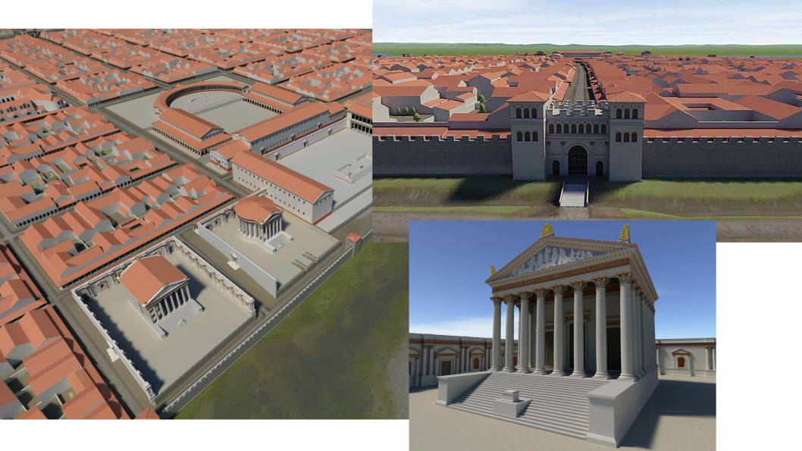
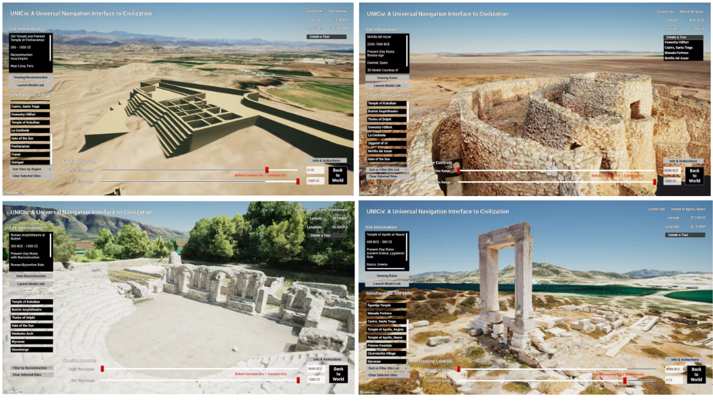
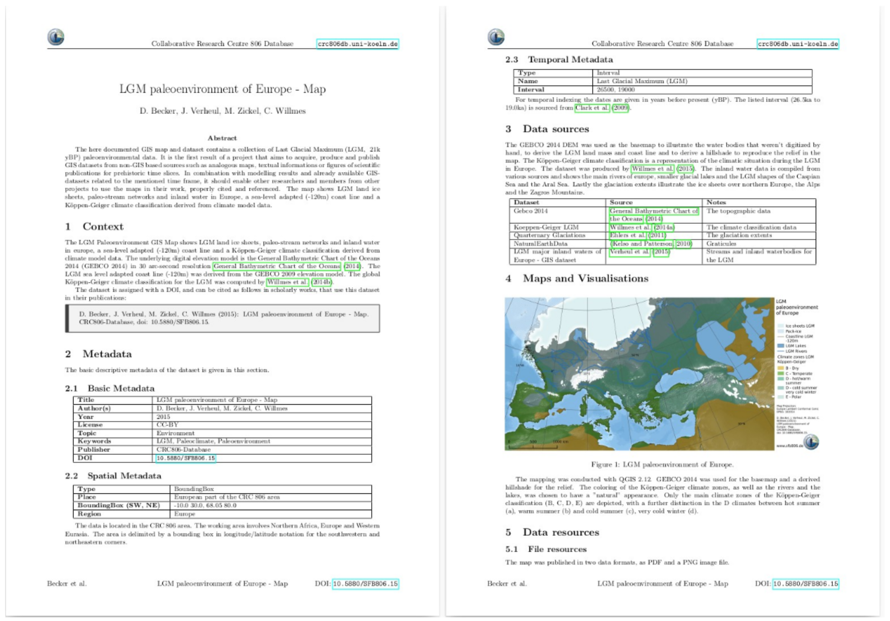
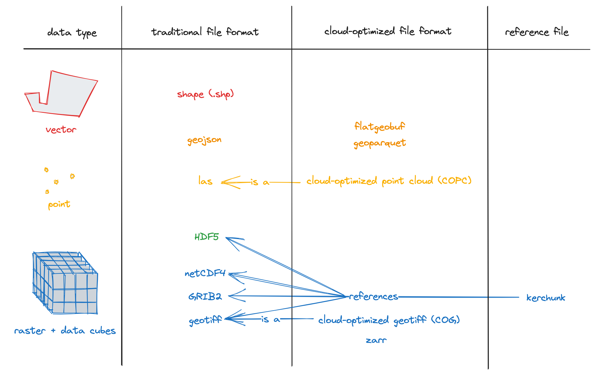

## The Vision

- A geobrowser that enables "time travel" across the Earth's surface — navigate, visualise and analyse landscapes as they were, are, and may become.
- Also, a well defined data model and comprehensive data basis for building spatiotemporal applications.

## Systemarchitecture Overveiw
- A (rough) high level overview of the Systemarchitecture

```{mermaid}
---
config:
  layout: elk
  look: handDrawn
  theme: neutral
---
graph TD
    A[Data Collection & Publication] --> B["Data Storage & Distribution (Server)"]
    B --> C["Applications (Clients)"]
    
    A1[Data Models] -.-> A
    A2[Data Formats] -.-> A
    A3[Publication Framework] -.-> A
    
    B1["Storage (S3 & IPFS)"] -.-> B
    B2["Matadisco"] -.-> B
    B3[LOD SematicWeb] -.-> B
    
    C1[WebApp] -.-> C
    C2[QGIS Plugin?] -.-> C
    C3[API?] -.-> C
    
    classDef tier1 stroke:#38bdf8,fill:#f0f9ff
    classDef tier2 stroke:#a78bfa,fill:#f5f3ff
    classDef tier3 stroke:#4ade80,fill:#f0fdf4
    classDef component stroke:#fb923c,fill:#fff7ed

    class A tier1
    class B tier2
    class C tier3
    class A1,A2,A3 component
    class B1,B2,B3 component
    class C1,C2,C3 component
```

::: {.aside}
Source: [https://github.com/SpaceTimeArc/Systemarchitecture](https://github.com/SpaceTimeArc/Systemarchitecture)
::: 

## Virtual Globe + Timeslider

- Interactive 3D globe that is not frozen in the present — a time axis you can scrub to explore the planet's past, present and future

- Something like [AncientEarthGlobe](https://dinosaurpictures.org/ancient-earth#0) but also for future and much more data sources.

- But the main product will not be geovisualization apps but integrated 4D landscapes, that can be the basis for spatiotemporal Human-Environment Interaction modellig applications, and much more.

- It will be a data infrastructure to facilitate Integrative Geography


## 3D Geo + Time = 4D Geo  


{fig-align="center" width="80%"}


## 3D Geo + Time = 4D Geo  

{fig-align="center" width="80%"}

## Data basis: Integrated 4D landscapes

- What kind of Environmental and Cultural data are available for past, present and future?

- We want to compile semantically well defined spatiotemporal data sets.

- Data gets integrated by space time context

  - Space is easy -> GIS Data formats (CNG)
  - Time is hard (heterogeneous concepts for naming time periods of the past) -> Ontology /data model

## Science: Data publication

- The 4D environmental and cultural datasets can and should be peer reviewed and published in proper venues like scientific journals, data journals and data repositories

- These data should be published in CNG (or 3DTiles for 3D) formats

- And published via Matadisco, so these datasets can be found form the client apps implementing our system.


## Paleomaps

- A framework to collect GIS datasets of past times to support archeological-environmental modelling.

.](figs/paleomaps.png){fig-align="center" width="80%"}

## Plaeomaps: Data publication

- The idea is to professionalise the dataset compilation and publication by submitting these datasets as data publications in peer-reviewd (data) journals.

{fig-align="center" width="80%"}

## Data: Cloud-Native Geospatial

{fig-align="center" width="80%"}

::: {.aside}
Source: [guide.cloudnativegeo.org/images/cogeo-formats-table.png](https://guide.cloudnativegeo.org/images/cogeo-formats-table.png)
:::

## Data: Semantic layer

- Data integration based on Linked Open Data and formal data models / ontologies / terminologies
- CIDOC CRM based geo-lod ontology: GeoScience-FAIRification-LOD
- Temporal Data Model/Ontology like Perio.do 
- Wikidata
- Completely reproducible by publishing the ELT code (Jupyter Notebooks)

## Data: Matadisco

- Distributed data publication and discovery
- An open, decentralized network for data discovery. Publish metadata about any dataset to AT Protocol. Build community portals. Find what matters.
- [https://matadisco.org](https://matadisco.org)


## It's all about the data

- Data infrastrucuture -> integration, access and discovery needs to be sorted/solved first.

- In times of AI vibecoded apps, client apps are not the (main) problem anymore.

- The is almost unlimited research potential for creating and compiling 4D landscape data sets.

- We create a (scientific peer-reviewed) 4D model of the earth.


## Comrades-In-Arms

- We (Florian, Volker, Abhijith, Shruti, Yogiraj, Rijin and Me) need any helping hands and minds for creating this system.

- Get in contact with us if you want to join our effort.

- We will give a Presentaion "Systemarchitecture for networked spatio-temporal human-environment-interaction data managemet" at [CHNT31](https://drive.google.com/file/d/1H1OU9D-d07Jk49pENQjQ1SsiXRZ955ii/view) in Vienna on 11.11. 

- We will hand in an abstract for the upcomming [FOSSGIS Conference in March 2027 in Heidelberg](https://fossgis-konferenz.de/2027/callforpapers/).

- Join or keep an eye on our [github](https://github.com/orgs/SpaceTimeArc/) organization.


