# Introduction {background-color="#9a3412"}

## The Vision

- A geobrowser that enables "time travel" across the Earth's surface — navigate, visualise and analyse landscapes as they were, are, and may become.
- Also, a well defined data model and comprehensive data basis for building spatiotemporal applications.

## Virtual Globe + Timeslider

- Interactive 3D globe that is not frozen in the present — a time axis you can scrub to explore the planet's past, present and future

- Something like [AncientEarthGlobe](https://dinosaurpictures.org/ancient-earth#0) but also for future and much more data sources.

- But the main product will not be geovisualization apps but integrated 4D landscapes, that can be the basis for spatiotemporal Human-Environment Interaction modellig applications, and much more.

- It will be a data infrastructure to facilitate Integrative Geography


## 3D Geo + Time = 4D Geo  


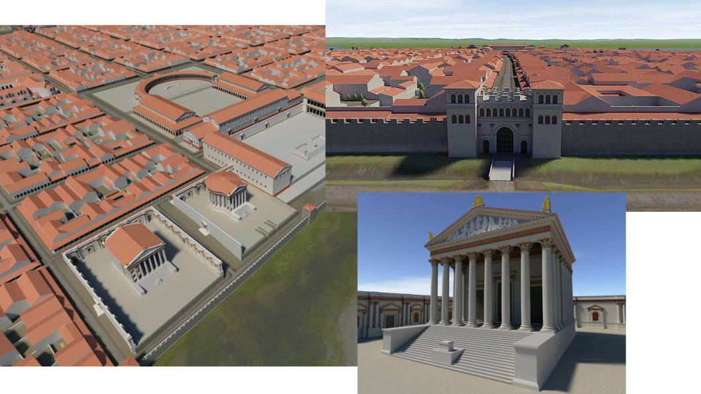{fig-align="center" width="80%"}


## 3D Geo + Time = 4D Geo  

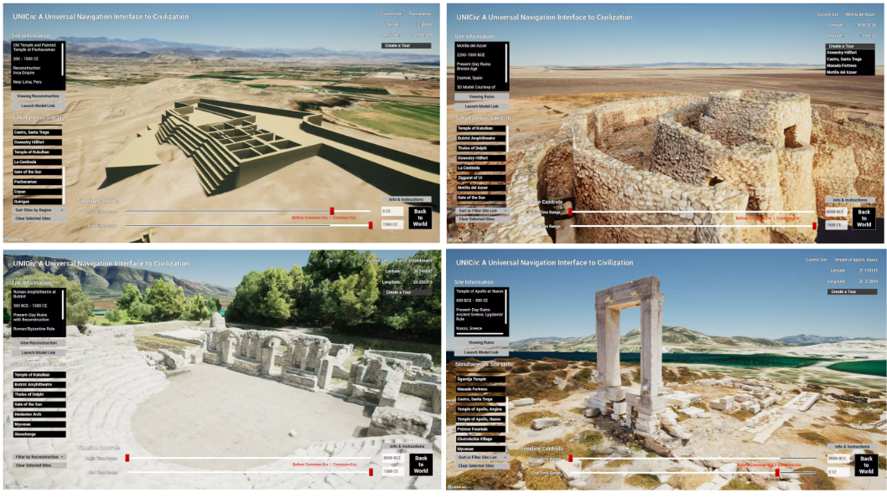{fig-align="center" width="80%"}


# Data basis {background-color="#9a3412"}

## Data basis: Integrated 4D landscapes

- What kind of Environmental and Cultural data are available for past, present and future?

- We want to compile semantically well defined spatiotemporal data sets.

- Data gets integrated by space time context

  - Space is easy -> GIS Data formats (CNG)
  - Time is hard (heterogeneous concepts for naming time periods of the past) -> Ontology /data model

## 4DLandscape: Data publication

- The 4D environmental and cultural datasets can and should be peer reviewed and published in proper venues like scientific journals, data journals and data repositories

- These data should be published in CNG (or 3DTiles for 3D) formats

- And published via Matadisco, so these datasets can be found form the client apps implementing our system.


## 4DLandscape compilations 

- Based on the original PaleoMaps idea (@Willmes2016, @willmes_paleomaps_2017, @willmes_paleomaps_2022) a framework to collect GIS datasets of past (and future) times to support archeological-environmental and future-scenario modelling will be developed.

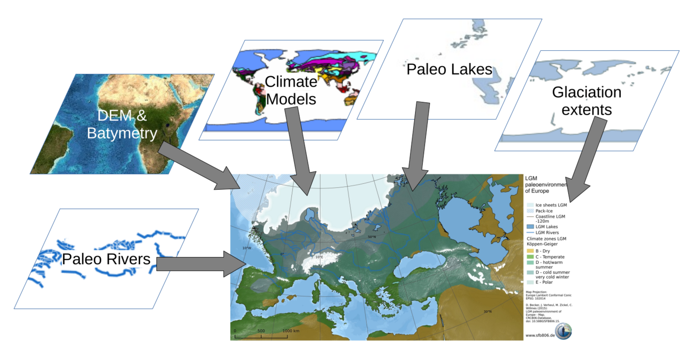{fig-align="center" width="80%"}

## 4DLandscapes: Data publication

- The idea is to professionalise the dataset compilation and publication by submitting these datasets as data publications in peer-reviewd (data) journals.

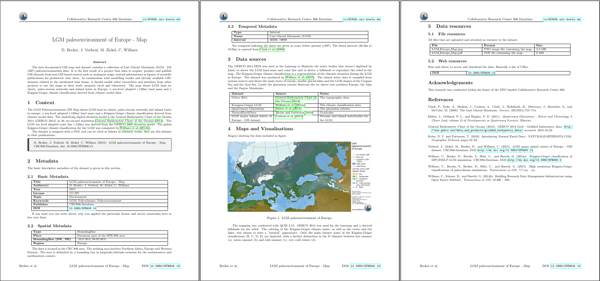{fig-align="center" width="80%"}

## 4DLandscapes: well defined Data model

- For the SpaceTimeArc System and Application we aim to develop a common "stadardized" data model for spatio-temporal environmental and human (antropogenic infrastructure) data.

- The data model consists of several thematic layers (as are commonly used in the GIS field), which are compiled from scientific sources for the time periods defined in the temporal model.

- All datasets should be linked to their sources or placed in context. Corresponding bibliographies should be “exportable” for each spatiotemporal data/layer configuration.

## Human Layer / Archeological Data

- Archaeological findspots are a data layer of their own, linked to the environmental record in the same space and time
- Example: one volcanic eruption leaves a tephra layer that ties archaeological sites, cores and their chronologies together

## Archaeological sites with Campanian Ignimbrite tephra {.figure}

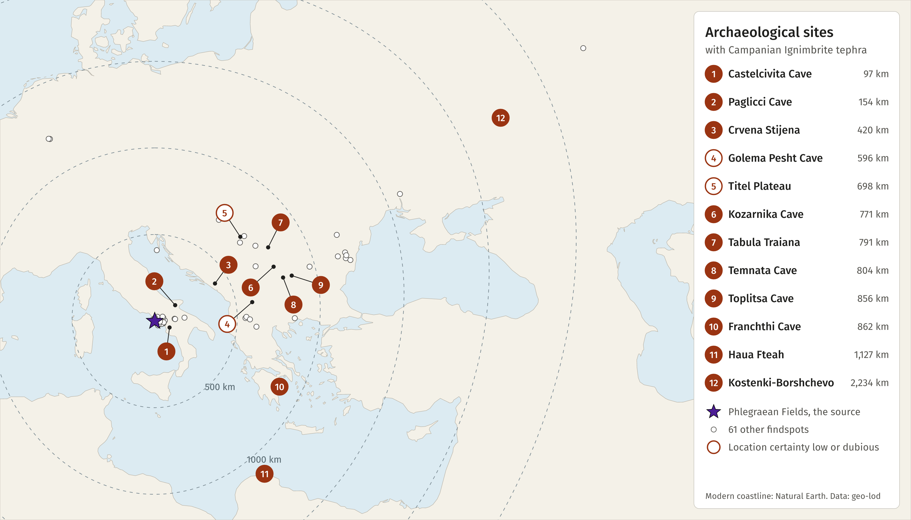{.r-stretch fig-alt="Map of archaeological sites with Campanian Ignimbrite tephra, up to 2,234 km from the source"}

::: {.figcap}
Tephra of the Campanian Ignimbrite eruption was found at archaeological sites up to 2,234 km from its source in the Phlegraean Fields.

::: {.src}
Data: geo-lod CI findspots; coastline Natural Earth | Figure: Florian Thiery, CC BY 4.0
:::
:::

# Technology {background-color="#9a3412"}

## Systemarchitecture Overveiw

- A (rough) high level overview of the Systemarchitecture

```{mermaid}
---
config:
  layout: elk
  look: handDrawn
  theme: neutral
---
graph TD
    A[Data Collection & Publication] --> B["Data Storage & Distribution (Server)"]
    B --> C["Applications (Clients)"]
    
    A1[Data Models] -.-> A
    A2[Data Formats] -.-> A
    A3[Publication Framework] -.-> A
    
    B1["Storage (S3 & IPFS)"] -.-> B
    B2["Matadisco"] -.-> B
    B3[LOD SematicWeb] -.-> B
    
    C1[WebApp] -.-> C
    C2[QGIS Plugin?] -.-> C
    C3[API?] -.-> C
    
    classDef tier1 stroke:#38bdf8,fill:#f0f9ff
    classDef tier2 stroke:#a78bfa,fill:#f5f3ff
    classDef tier3 stroke:#4ade80,fill:#f0fdf4
    classDef component stroke:#fb923c,fill:#fff7ed

    class A tier1
    class B tier2
    class C tier3
    class A1,A2,A3 component
    class B1,B2,B3 component
    class C1,C2,C3 component
```
 


## Cloud-Native Geospatial {.figure}

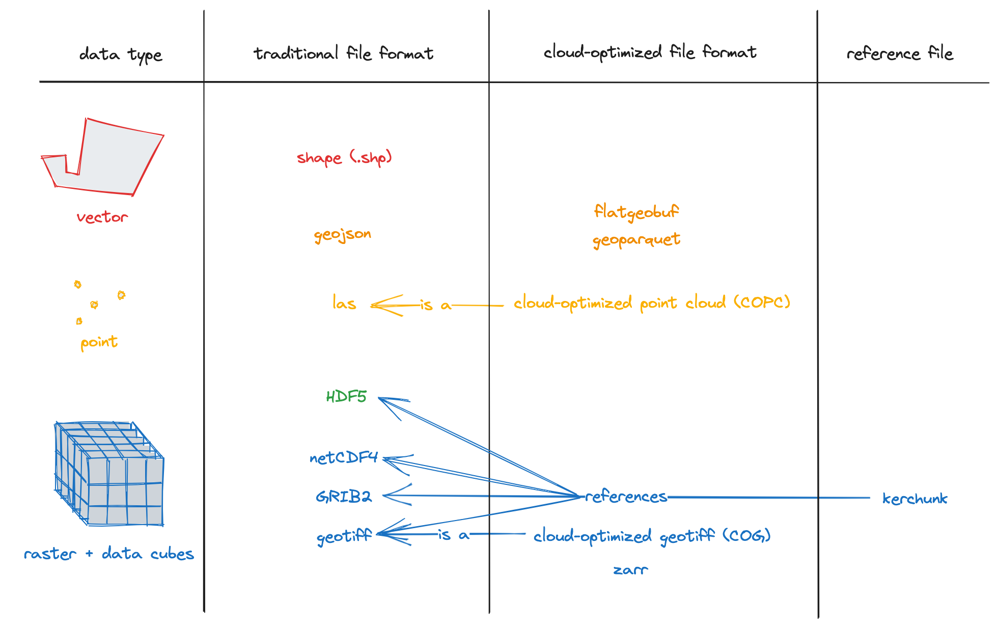{.r-stretch fig-alt="Table of cloud-native geospatial file formats: traditional versus cloud-optimized formats for vector, point cloud and raster data"}

::: {.figcap}
Cloud-native geospatial file formats: traditional vs. cloud-optimized formats.

::: {.src}
Source: [guide.cloudnativegeo.org/images/cogeo-formats-table.png](https://guide.cloudnativegeo.org/images/cogeo-formats-table.png)
:::
:::

## Semantic layer

- Data integration through Linked Open Data: every dataset row becomes statements in a graph
- CIDOC CRM and its extensions as shared backbone, with domain modules on top
- Time: periods referenced through [PeriodO](https://perio.do), modelled ages kept with their source
- Identity: places, sites, people and events linked to Wikidata
- Reproducible: ELT notebooks (Jupyter) published together with the data

## The semantic layer from data to discovery {.figure}

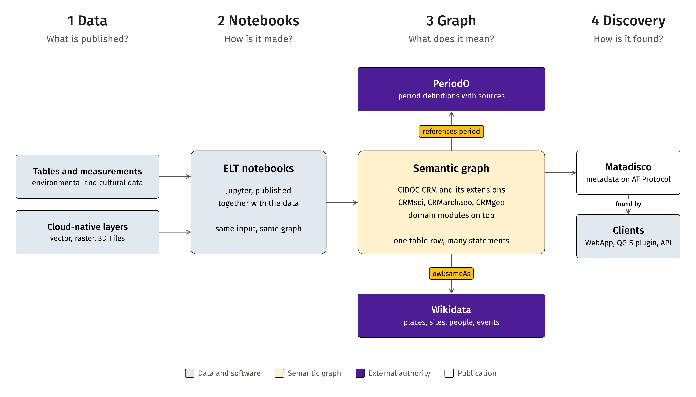{.r-stretch fig-alt="Four columns: published data, ELT notebooks, a CRM-based graph with PeriodO and Wikidata, and discovery through Matadisco"}

::: {.figcap}
Published data are transformed by open ELT notebooks into a CRM-based graph, linked to PeriodO for periods and Wikidata for places and events, and found through Matadisco.

::: {.src}
Figure: Florian Thiery, CC BY 4.0
:::
:::

## Demonstrator: geo-lod

- [GeoScience-FAIRification-LOD](https://github.com/Research-Squirrel-Engineers/GeoScience-FAIRification-LOD) shows how the semantic modelling will look across the project
- A first selection of datasets: EPICA Dome C ice core, SISAL stalagmites, Campanian Ignimbrite findspots
- More datasets and modules will follow

## One CRM family, three modules {.figure}

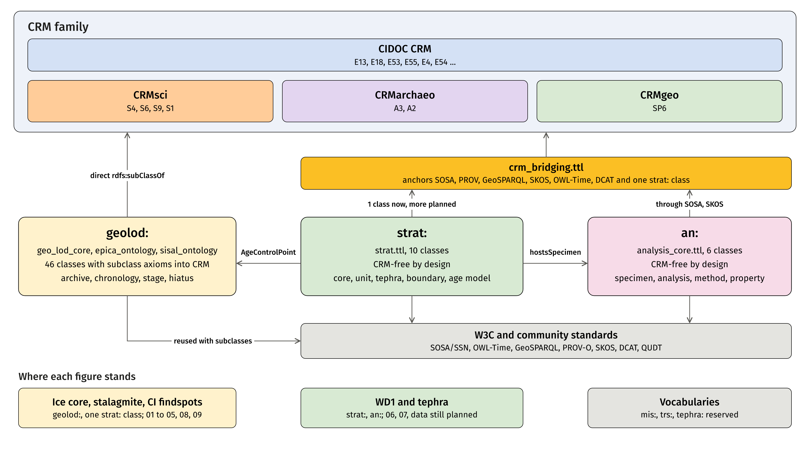{.r-stretch fig-alt="The geolod, strat and an modules and how they connect to CIDOC CRM, CRMsci, CRMarchaeo and CRMgeo"}

::: {.figcap}
In geo-lod the geolod, strat and an modules are anchored in CIDOC CRM and its extensions CRMsci, CRMarchaeo and CRMgeo.

::: {.src}
Data: ontology modules of geo-lod | Figure: Florian Thiery, CC BY 4.0
:::
:::

## Example: one table row becomes statements in CIDOC CRM {.figure}

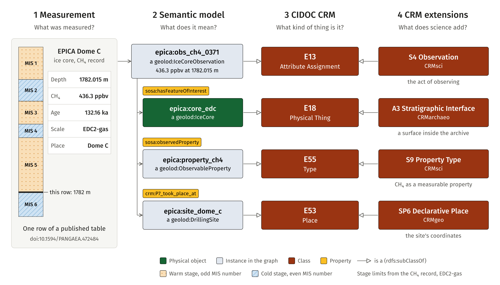{.r-stretch fig-alt="One methane measurement from the EPICA Dome C ice core as an observation, an ice core, a property and a place in CIDOC CRM"}

::: {.figcap}
A single CH4 value from the EPICA Dome C ice core is stated as an observation of an ice core, a property and a place.

::: {.src}
Data: Spahni & Stocker 2006, doi:10.1594/PANGAEA.472484 | Figure: Florian Thiery, CC BY 4.0
:::
:::

## Example: one stalagmite, three kinds of statements {.figure}

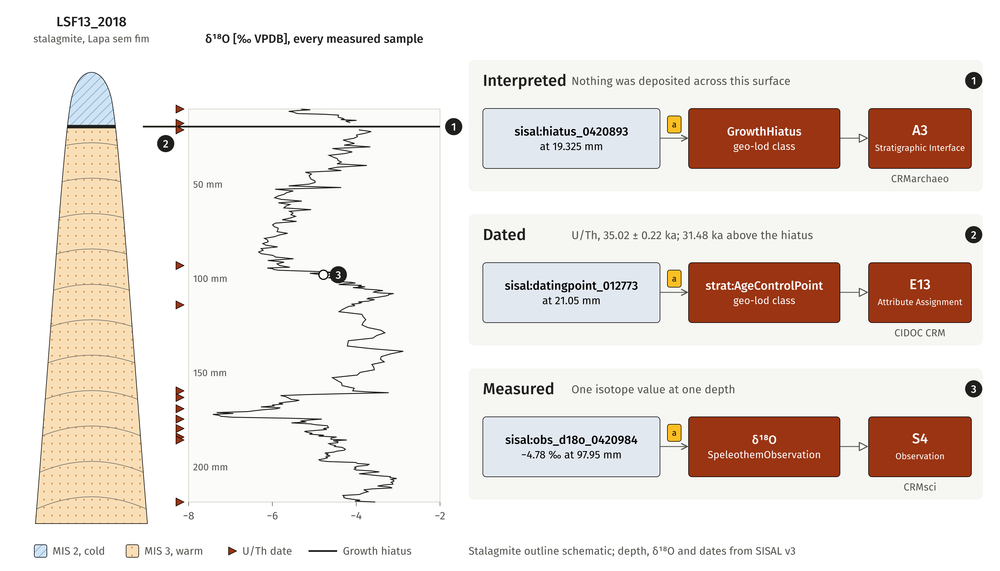{.r-stretch fig-alt="Stalagmite LSF13_2018 with an isotope value, a U/Th date and a growth hiatus, each anchored in CIDOC CRM"}

::: {.figcap}
For stalagmite LSF13_2018 an isotope value, a U/Th date and a growth hiatus are kept apart as measured, dated and interpreted statements.

::: {.src}
Data: SISAL v3; stalagmite outline schematic | Figure: Florian Thiery, CC BY 4.0
:::
:::

## Example: the graph says where, the measurement says what {.figure}

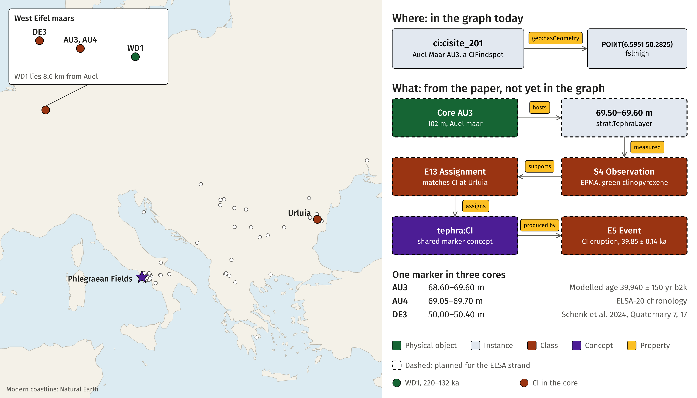{.r-stretch fig-alt="Campanian Ignimbrite findspots in the West Eifel maars and the planned model of the tephra measurements"}

::: {.figcap}
Findspot positions are in the graph today; the tephra measurements from the West Eifel maar cores are planned (dashed).

::: {.src}
Data: Schenk et al. 2024, Quaternary 7, 17 | Figure: Florian Thiery, CC BY 4.0
:::
:::

## Matadisco

- Distributed data publication and discovery
- An open, decentralized network for data discovery. Publish metadata about any dataset to AT Protocol. Build community portals. Find what matters.
- [https://matadisco.org](https://matadisco.org)


# Conclusions {background-color="#9a3412"}

## It's all about the data

- Data infrastrucuture -> integration, access and discovery needs to be sorted/solved first.

- In times of AI vibecoded apps, client apps are not the (main) problem anymore.

- There is almost unlimited research potential for creating and compiling 4D landscape data sets.

- We create a (scientific peer-reviewed) 4D model of the earth.


## References

::: {#refs}
:::

## Figure credits {.smaller}

- Semantic layer and archaeology figures: [GeoScience-FAIRification-LOD](https://github.com/Research-Squirrel-Engineers/GeoScience-FAIRification-LOD), figures CC BY 4.0, Florian Thiery
- EPICA Dome C data: Spahni & Stocker 2006, doi:10.1594/PANGAEA.472484
- Campanian Ignimbrite findspots: geo-lod CI findspots; model after Schenk et al. 2024, Quaternary 7, 17; coastline Natural Earth

