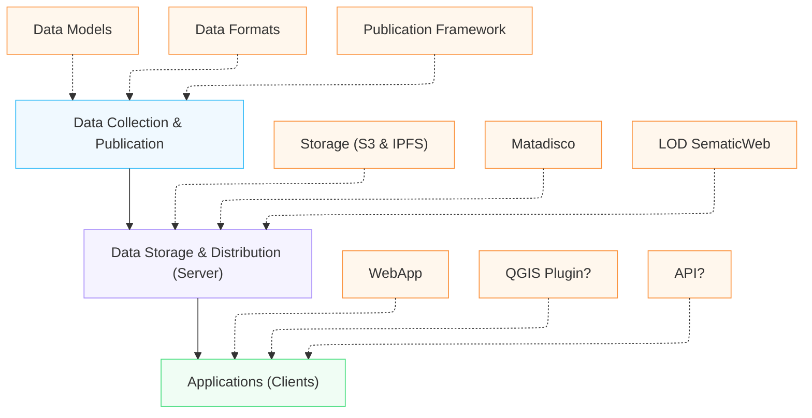

This repository is the place for developing the overall Systemarchitecture of SpaceTimeArc.

# High Level Systemarchitecture (first draft)

SpaceTimeArc is a system to integrate environmental data and human data for past, current and future human environnment interaction (geography) research and for educational SpaceTimeBrowsing of the planets history and future.

Technically, the SpaceTimeArc is a three tier System of Systems. The fist tier, Data collection & Publication, is the foundation of the system, where the data models, data formats and the data publication framewor or workflow are defined and developed. The second tier ist the Data Storage & Distribution or the Server or Cloud system. Where everything regarding storage, metadata mappings, data integrations, data access and discovery is defined and developed. The third tier are a set of client Applications that provide interfacecs to the SpaceTimeArc System.

# Tier 1: Data collection & publication

Concepts for handling the SpaceTimeArc data. 

## Data Models

- Space Time Model
- Environmental Model
- Human/Cultural Model

## Data Formats

Cloud Native Geo formats.

- vector
- raster
- mesh
- SpaceTimeCubes? (Zarr/GeoZarr, in combination with Icechunk or Xarray?) or better keep it simple and stupid to avoid technical hurdles for participating?

&nbsp;

## Data Publication

The idea is to develop a framework of precise technical workflows and documentation for how to compile and formally publish - including guidlines for peer review and citation of - SpaceTimeDatasets to the SpaceTimeArc System.

&nbsp;

# Tier 2: Data Storage & Distribution

&nbsp;

## IPFS and S3 Storage

How is the data stored?

Do we provide a IPFS or S3 Store?

It should be possible that anyone can host their data on their own S3 or IPFS infrastructure, or use cloud services.

(Look into Zenodo or OSF if S3 storage/URLS are available for uploaded data?)

&nbsp;

## Matadisco

System for decentralised publication of SpaceTimeArc datasets 

This will be mainly developed by @vmx

&nbsp;

## LOD & SemanticWeb

Ideas, tools, workflows for integrating SpaceTimeArc Datasets with the SemanticWeb.

This will be mainly worked on by @fthiery

&nbsp;

# Applications (Clients)

&nbsp;

## WebApp

A comprehensive webapp that implements all features of the system

&nbsp;

## QGIS Plugin

A plugin that will implement many features of the system.

Focus on dataset compilation and creation, as well as metadata publishing.

&nbsp;

## API

We could offer an API for programmatically working with the system or to provide access to third pary apps.